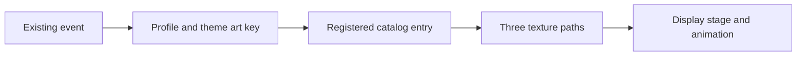

# KAPOW artwork implementation plan

Snapshot: 22 October 2026. This is a **future implementation plan and design discussion**, not completed work. Source references were inspected locally. No Lua/TOC/catalog changes were made in the artwork session. Read [handoff.md](/Users/erik2/Developer/WoW/PulseSensation/Kapow/UnimplementedArt/handoff.md) and the inventory first; recheck current code and dirty work before implementing.

Final artwork state: all 69 new message keys are approved and copied into staging, including the final five. There are 222 TGA files including five orange alternatives. No approval/generation work remains; the remaining work below is addon integration and optional design work.

## Scope and current architecture

The assets are already generated and exported. The main remaining job is making selected art selectable and associating it with appropriate moments, then implementing the optional VS composition. Do not regenerate the pack or rewrite event detection just to add textures.

| Source | Current responsibility / implication |
| --- | --- |
| `Art/_metadata/manifest.json` | Master catalog, still the older 47-message pack |
| `Kapow/UnimplementedArt/inventory.json` | New staged copies, variants, provenance and per-asset dimensions; not read by runtime |
| `scripts/make-art-catalog.py` | Reads master manifest/fonts, writes `Kapow/ArtCatalog.lua` and font credits, copies listed runtime files to `Kapow/Art` |
| `Kapow/Art.lua` | Builds runtime choices and derives three texture paths from `<category>/<message>` under `Kapow/Art`; it does not load this staging folder |
| `Kapow/Events.lua` | Event defaults, title/detail templates and default art choices |
| `Kapow/Themes.lua` | Per-theme event overrides; many thematic phrases remain normal FontString text |
| `Kapow/Display.lua` | Texture stage, positioning, title/detail text, frame playback, animation presets, fonts and sound |
| `Kapow/Profiles.lua` | Saved profiles, defaults, import/export and legacy art-key migration |
| `Kapow/Announcer.lua`, `Moments.lua`, `Detect.lua` | Existing delivery/detection paths; artwork import should not silently change their semantics |
| `Kapow/UI/EventsPage.lua` | Existing art/event selection UI; new catalog entries should join its established workflow |

The TOC already loads ArtCatalog, Art, Events, Display, Themes and Profiles. Texture files do not need one TOC line per image. Placing TGAs in a folder alone does not register them in menus or connect triggers.

## Import the selected artwork

Recommended approach: preserve this staging folder as the reviewed delivery and promote selected assets into the established master/runtime workflow.

1. Read approval state in `inventory.json` and the latest batch manifests. All current staged sequences, including the final five, are approved. Preserve that provenance and do not regenerate them.
2. Merge approved category/name keys into root `Art/_metadata/manifest.json` and its category lists. Preserve word, actual prompt/reference provenance, source path, frame order and per-asset size. Keep the original 47 assets and their original prompts.
3. Copy selected TGA bytes to root `Art/<category>/<message>_1.tga` through `_3.tga`. Keep high-resolution sources in their batch folders, or copy them into the root source layout with correct manifest paths. Do not destroy or overwrite batch provenance.
4. Preserve aliases/shared membership: RAMPAGE serves escalation and arena; SPLAT serves comic and falling. Deduplicate by **category/name or explicit asset key**, not normalized text alone. Arcade/arena EXCELLENT and comic/arcade K.O. are intentional style variants.
5. Keep the five orange alternatives. If exposing them in the runtime menu, give them explicit, stable variant keys and labels, e.g. `escalation/first-blood-orange`; ensure generated filenames/path resolution match those keys. Do not silently replace the selected recolors or weight random selection by accidental duplicate copies. An explicit path-aware catalog is another design option, but requires changing both generator and loader consistently.
6. Review root/runtime differences and dirty work before running `scripts/make-art-catalog.py`. It writes the catalog, font credits and recopies all listed art/fonts, not only new assets. Preserve unrelated current edits; do not use the script as a broad reset.
7. Once source promotion/conflicts are resolved, regenerate via the existing catalog script and confirm expected entries, exact paths and fonts are present. Keep `counterstrike` legacy migration mapped to current `tactical`; do not introduce a duplicate old category.

**Do not blindly run the old `Art/_metadata/export_assets.py`.** It currently hardcodes 256×256, rejects repeated normalized wording globally, and compares a recursive `Art/**/*.tga` scan to only the old manifest. New `_batches/` exports, category variants and VS512 break those assumptions. The final TGAs are already usable: prefer byte-preserving promotion, or first scope/refactor the exporter to per-asset dimensions, explicit listed paths, and key-based identity. It must not reprocess all sources merely to import existing exports.

## Map events and themes

Start by making the art selectable, then update defaults/theme presets deliberately. Examples below are suggested mappings, not event-detection changes or universal replacements.

| Existing event/context | Candidate art |
| --- | --- |
| firstblood | `escalation/first-blood` |
| triple, mega, ultra, monster, ludicrous | Corresponding new escalation keys; retain existing double/multi keys |
| spree5,15,20,25,30 | killing-spree, dominating, unstoppable, godlike, wicked-sick; spree10 keeps shared rampage |
| mvp / flawless | `arena/mvp`, `arcade/flawless`, or theme-specific equivalent |
| teammate / laststanding / petdown | `tactical/teammate-down`, `tactical/last-one-standing`, `failure/pet-down` |
| countgo / duelstart / bosspull | `arcade/fight`, `arcade/round-1-fight`; keep shared art for duel and boss contexts |
| duelwin / duellose | `arcade/you-win`, `arcade/you-lose` |
| assist / record / achievement | `tactical/assist`, `arcade/new-record`, `comic/achievement` |
| epicloot / quest / honorkill | `comic/epic-loot`, `comic/quest-complete`, `arena/honorable-kill` |
| Roadfighter youdied / wipe / encwipe | `arcade/game-over` / `arcade/continue` |
| Roadfighter interrupted / levelup | `arcade/guard-break` / `arcade/level-up` |
| Football fight start/end or interrupts | Existing/new sports words as appropriate; select by theme, not a global forced arcade replacement |
| Falls | Preserve current WHEEE/FACEPLANT/GRAVITY WINS choices; SPLASHDOWN/OOF/CRATER are additional choices, not evidence of new detection |

When art already contains the full wordmark, clear a redundant overlaid title if appropriate; retain the detail/sub line for damage, victim, count or level. Do not lose useful contextual text while removing duplicate lettering.

**BLOCKED is not a generic avoidance label.** The current testing event `avoid` groups dodge/parry/block/miss and is off by default. Do not label every avoidance as BLOCKED or enable new detection just because the asset exists. Use it only when a verified non-secret/plain signal identifies a block, or leave it as a selectable manual/testing asset. The same distinction applies to semantic variants such as IMMUNE, PARRY or healing that do not yet have implemented events.

Preserve configured event meanings. In particular, leaving combat is not automatically a victory, a killing-blow asset is not proof of final-blow attribution, and the existence of a texture does not establish a reliable trigger. Respect existing toggles and keep optional detection changes separate.

## Animation, dimensions and profiles

- Current `Art.lua` frame durations are 0.08 / 0.12 / 0.18 seconds. `Display.lua` supports flipbook, slam, bounce, rise, shake and static presets.
- `slam` and `static` currently have `flip=false`; they display the **middle peak frame**. Flipbook/bounce/rise/shake play the three texture states. Decide whether to add a slam-plus-flipbook option or use an existing flipping preset; do not promise three-frame motion while selecting a non-flipping preset.
- Preserve frame order and a stable center anchor. Small generated differences exist; do not add per-frame recentering or aggressive stretching that amplifies jitter. Test actual playback, not just peak thumbnails.
- Source resolution and display size are different. VS has512px textures, but the current display texture size is fixed at256 before other scaling. Introduce separate display width/height or a dedicated VS stage if needed, without making all banners512 or globally stretching their layout.
- Keep texture opacity separate from root opacity so a translucent VS does not unintentionally fade portraits, names, damage details or other UI together. Test all three VS frames; do not force generated254 alpha to255 as a cosmetic fix.
- Existing saved profiles contain explicit choices and fill only missing defaults. Updating Events/Themes may not change a user's existing configuration. Offer an explicit apply-theme action or narrowly scoped migration that preserves custom art, fonts, durations, toggles, positions and imported profiles. Keep stored keys stable and retain existing legacy aliases.
- Color variants should be clearly labeled in selection/preview UI. Avoid treating every variant as an additional random choice unless the user explicitly chooses that weighting.

## VS portrait intro concept

**Requested concept:** the player's and enemy target's in-game 3D portraits, very large, stretched/cropped, translucent, with an oversized semitransparent VS between them. The generated VS texture is complete; no portrait code or live feasibility test has been performed.

Suggested starting design, all values tunable:

- Player on the left, target on the right, chest/head crop and slightly stretched horizontal framing. Test exaggerated stretching across player races and NPC shapes; adjust camera/crop instead if it looks distorted.
- Portrait opacity around30%; VS around65%. Separate controls for each portrait and VS, size, width/height, crop, placement and intro duration. These are brainstorming defaults, not final requirements.
- Short opposing slide-in, brief VS flash, then fade as FIGHT lands. Avoid layering multiple full-screen bursts or letting the intro obscure ordinary combat information.
- Build a dedicated reusable composition/stage. Create/reuse model frames rather than allocating them on every damage event. Trigger on deliberate encounter/duel/fight-start contexts, not repeated hits.
- Validate the appropriate unit-model/portrait APIs, alpha behavior, camera/facing options and unit availability in this machine's actual Forever client and local source before choosing implementation. The source snapshot is older than the installed client; no unverified API is guaranteed here.
- Player/target can be missing, dead, changed, non-humanoid or unsupported. Define graceful fallback: VS alone, existing 2D portrait fallback, or skip intro. Handle target-change/cancellation through safe observable events; do not branch on or convert secret names/GUIDs to fake stable identity.
- Preserve protected-frame ownership and combat rules. Enemy names/other secret values remain presentation-only via existing safe formatting paths. Do not inspect, stringify, compare or perform arithmetic on secret payloads for layout or intro decisions.
- Include an opt-out/reduced-motion path, sensible opacity/size limits, cooldown/queue behavior, and immediate cleanup on zoning, logout, cancellation or UI reload. Test frame strata, clipping, target churn and repeated intros.

This is not a request to generate static character portraits. The actual game models are the intended content.

## Validation and acceptance

Integration checks should verify behavior, not merely mirror the code:

1. Every registered asset resolves to exactly three existing files, with correct category/name paths and variant labels. Keep VS512 and other256 dimensions intact; compare promoted bytes to staging hashes.
2. Check direct art choice, random category/all, font matching, defaults, apply-theme behavior, import/export and older saved profiles without resetting custom settings.
3. Preview onset/peak/aftershock, timing, alpha, crop, rotation/scale and each chosen animation. Confirm baked title text is not duplicated and details remain readable.
4. Run relevant existing Lua5.1-compatible checks/tests after actual code changes, for example `python3 /Users/erik2/Developer/WoW/.devtools/wowdev.py check PulseSensation --tests`; add lint where relevant. Use the project tests rather than broad new mirror tests.
5. In the real client, reload and test menus/fonts/textures, representative events, profiles, combat transitions and the optional VS stage. Verify trigger delivery and attribution independently of asset loading. Offline checks do not establish live event/security behavior.
6. Inspect fresh logs if errors/taint appear. Preserve secret-safe presentation and protected ownership. Recheck the installed client version and source compatibility rather than copying retail assumptions.

Accepted art caveats are in the inventory and batch validation notes. Do not turn integration into another regeneration/QA project. No release or package should be called shipped until the requested native packaging and relevant client checks have actually happened.

## Optional brainstorming and deferred art

**No further generation is authorized by this handoff.** The user specifically said the last five and wrap up. These are ideas to discuss in a later task:

- Countdown **3 / 2 / 1** to complete the round-start sequence; use font-rendered numerals as an inexpensive option before commissioning more textures.
- Additional exact theme wording, e.g. BROKEN STANCE, TEAM WIPED, TACKLE!, CLEAN SHEET, CHAMPIONS! or RANK UP. Many current theme labels intentionally reuse generic art or font text; full literal coverage is not required. The pre-final-five audit found115 normalized static phrases without matching banner wording, not115 missing mandatory assets.
- Defensive feedback such as PARRY, DODGE, IMMUNE, RESIST or ABSORB; healing/support such as CRITICAL HEAL, SAVED or REVIVED. These need event feasibility and semantic decisions first. Existing generic MISS/WHIFF/NOPE/COUNTER may already be enough.
- Revenge/payback, comeback or shutdown moments; specify reliable plain event evidence and avoid inventing secret-based attribution.
- A reusable damage-number style matched to each bundled font, with readability at small scale tested in-game. Raster banner lettering and functional TTF text need not match pixel-for-pixel.
- Sparse graphic-only overlays—slashes, flashes, rings—could support more runtime variation without baking every phrase into a new bitmap. Keep any future generated originals and actual prompts.
- Optional original announcer/impact audio. The sound prompt database is a separate project; first audit existing built-in/custom pools and choose an original voice direction. This art work did not generate or verify a new audio pack.
- A compact art browser with variant previews and a motion preview could make existing choices easier to use; avoid a wholesale settings rewrite.

Frame-count increases, exact glyph alignment repairs, alternative512 exports and broader style reworks are optional polish only after the user identifies a concrete need. Preserve all accepted original versions.

## Suggested implementation order

1. Confirm the approved inventory and selected variants; preserve current work.
2. Promote approved selected files/metadata and reconcile the master generator/exporter assumptions.
3. Regenerate the active catalog safely; verify menu/path resolution and fonts.
4. Update event/theme art defaults with profile-safe behavior and remove redundant titles.
5. Enable appropriate three-frame playback choices and verify timing/size.
6. Implement the optional VS portrait stage as a separate, testable feature.
7. Perform relevant offline checks and real-client verification, then update these documents with what was actually done.

Do not implement every brainstorming item or generate more art automatically. The deliverable of the current task is the artwork plus this handoff, not a code release.
